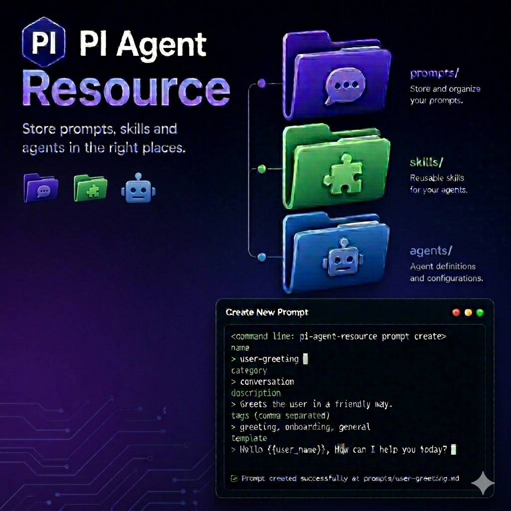

# @code-fixer-23/pi-agent-resource

`@code-fixer-23/pi-agent-resource` is a Pi extension package for creating, editing, and organizing Pi resources—agents, prompts, skills, and MCP servers—without leaving the Pi interface. Its extensions cover the full lifecycle of each resource type: form-based creation with validated metadata, external editor integration for rich content, scoped placement in either your global Pi home or the current project directory, and pack management that bundles resources together and teaches Pi how to discover them during a session.

Every resource type in Pi follows strict layout conventions—correct frontmatter keys, `skills/<name>/SKILL.md` directory nesting, grouped prompt directories with `_index.md`, and so on. This package handles all of that so you can focus on writing the content itself. Each manager provides global and local variants of create, edit, and delete, with the same form and editor workflows in both scopes.

[](https://www.npmjs.com/package/@code-fixer-23/pi-agent-resource)
[](https://www.npmjs.com/package/@code-fixer-23/pi-agent-resource)
[](https://github.com/louiss0/pi-packages/blob/main/LICENSE)
[](https://github.com/louiss0/pi-packages/actions/workflows/ci.yml)



## Agent Manager

The agent manager creates and maintains agent definition files in either your global Pi home (`~/.pi/agent/agents`) or the current project's `.pi/agents` directory. All three subcommands work the same way regardless of scope; the only difference is where the resulting file is written.

### Commands

#### `resource:agent <create|edit|delete>`

Manages agents in `~/.pi/agent/agents`.

`create` detects a Tintin or Nico authoring profile (or asks when detection is ambiguous). The workflow is **metadata form → Markdown system prompt → review/save**. Name, description, model, and tool checkboxes appear together in one form; there are no field-by-field menus, CSV-entry dialogs, or separate filename prompts. The filename is derived automatically from the agent name; there is no filename field. Select **Include advanced settings** only if you want to fill optional section forms before the prompt. Declining the final review returns to the metadata form with your edits retained. New definitions prefill `tools: read,write,edit`; remove `write` and `edit` if the agent should not change files. Before saving, it requires `name` (lowercase letters, numbers and dashes, up to 48 characters), `description` (35–1024 characters), `tools` (nonempty comma-separated selectors without uppercase letters), and `model` (2–128 lowercase letters, numbers, colons or dashes). Other supported fields are optional. These are authoring rules, not a claim that either subagent runtime requires those four fields. The extension writes validated frontmatter but does not load or execute the agent.

`edit` presents existing global agent definitions and opens the same structured metadata and Pi prompt editor. It does not require `$VISUAL` or `$EDITOR`. Unchanged legacy definitions remain readable; changed definitions must pass the four-field save validation; the default tools are applied only to new definitions. The embedded tools MultiSelect offers Valibot-validated registered tools plus the builtin defaults, and preselects existing tools without discarding unknown saved selectors. Tintin builtin tools remain plain names; registered extension tools use `ext:` selectors. Nico registered names remain unchanged. Existing `ext:` selectors are never double-prefixed. The catalog is advisory: tools present in the parent session are not guaranteed to load in the child agent, and tools absent now may be available there. The model rule still excludes provider/model paths.

Advanced settings use directly fillable section forms with schema-directed value selectors, numeric inputs, and text fields. Declared nested settings appear as ordinary fields in the same form; typing into them automatically supplies their parent mapping. There are no storage-type questions, “Custom value” activation steps, or mode-switching shortcuts. Use `Tab` to switch fields, `←→` or `Space` to change known values, and `Enter` on the last field to apply the section. Tool and enumerated-list checkboxes use `↑↓` and `Space`; freeform lists use one entry per line with `Shift+Enter` for newlines. Optional blank inputs stay omitted so the runtime supplies its defaults. Arbitrary mappings and structured collections use a directly editable JSON field. Validation errors keep the form open; `Esc` cancels the section without applying edits. Long forms scroll to keep the focused field visible.

For Nico definitions, the manager emits structured `toolBudget` and `outputSchema` as inline JSON and simple selector lists as unquoted YAML block lists. It refuses empty top-level lists because Nico reads `[]` as a literal selector; omit the field or use empty text instead. The extension tests these boundaries against the pinned Tintin 0.19.0 and Nico 0.77.0 loaders.

`delete` shows the same selection list and removes the chosen file.

#### `resource:local-agent <create|edit|delete>`

Runs the same create/edit/delete workflows against the current project's `.pi/agents` directory. Before making any change, the extension announces the resolved path so it is clear which workspace it is about to modify. This is useful when the agent should travel with a repository rather than live in your global Pi home.

---

## Prompt Manager

The prompt manager handles prompt files in `~/.pi/agent/prompts` or the project-local `.pi/prompts` directory. Prompt creation is a two-stage workflow because prompts have two distinct parts: structured frontmatter metadata and a freeform markdown template body.

### Commands

#### `resource:prompts <create|edit|delete>`

Manages prompts in `~/.pi/agent/prompts`.

`create` works in two stages. First, a form collects the required frontmatter fields: `name`, `description`, and the optional `argument-hint` field (validated for correct syntax). Once the metadata passes, the workflow continues into your external editor where you write the markdown template body. The prompt file is written only after both stages complete successfully.

`edit` opens an existing prompt in your external editor (`$VISUAL` or `$EDITOR`).

`delete` understands the difference between a plain prompt file and a grouped prompt (a directory containing `_index.md`). Selecting a grouped prompt removes the entire directory rather than just the index file, keeping the prompt layout clean.

#### `resource:local-prompt <create|edit|delete>`

Runs the same workflows against `.pi/prompts` in the current project. Local prompts are useful for repo-specific conventions or prompt packs that should travel with the repository.

---

## Skill Manager

The skill manager maintains the `skills/<name>/SKILL.md` layout that Pi requires. Skills live in `~/.pi/agent/skills` globally or in `.pi/skills` locally. Creation is staged so the common path stays short while still allowing richer metadata when needed. After any edit, Pi reloads automatically so the updated skill is immediately available.

### Commands

#### `resource:skill <create|edit|delete>`

Manages global skills in `~/.pi/agent/skills/<name>/SKILL.md`.

`create` runs in two stages. The first form collects the required `name` and `description` fields and ends with a confirmation checkbox: if you confirm, a second form appears to collect optional metadata (`license`, `compatibility`, `allowedTools`). Skipping the optional form still creates a valid skill; the confirmation just unlocks the extended fields for when you need them.

`edit` resolves the editing mode before opening anything. It first checks whether `--external-skill-editor` was passed, then reads the `[skill]` section of `.pi-resource.toml` if neither flag is set. After saving, Pi reloads so the skill is available in the current session without a manual restart.

`delete` removes the entire skill directory—not just the `SKILL.md` file—keeping the layout clean for when the skill is re-created later.

#### `resource:local-skill <create|edit|delete>`

Runs the same lifecycle against `.pi/skills/<name>/SKILL.md` in the current project. Useful for repository-scoped skills that ship with the codebase.

#### `resource:skill:invocation`

Opens a combined checkbox list of the skills loaded in the current Pi session, including global, project-local, `.agents`, package, and explicitly configured skills. Each entry shows its scope and file path; disabled skills are already checked. This uses `MultiSelect` from `pi-form-components` and requires TUI mode.

- **Checked** sets `disable-model-invocation: true`: the skill is hidden from automatic model selection but remains available through `/skill:name`.
- **Unchecked** allows automatic model selection (`disable-model-invocation: false`).
- Use **↑↓** to navigate and **Space** to toggle. **Enter** saves changed skill files and automatically reloads the current session once. **Esc** discards staged changes without writing or reloading.

Changes persist in each skill's own frontmatter, preserving its other metadata, comments, and Markdown body. Unreadable or unsupported/malformed frontmatter is reported and skipped. Files changed while the list was open are not overwritten; reopen the command to retry. Save failures are reported individually, and any successfully saved changes are still reloaded. Package updates may replace edits made to package-provided skills. Skills excluded from Pi's loaded resource catalog (for example, losing name collisions) are not shown.

### Flags

#### `--external-skill-editor`

`--external-skill-editor` is a boolean flag that forces the `edit` subcommand to open the skill file in your external editor (`$VISUAL` or `$EDITOR`). It applies only to `edit`; passing it with `create` or `delete` produces an error.

### Features

**`.pi-resource.toml` editor configuration**

When `--external-skill-editor` is not set, the edit workflow consults a project-level `.pi-resource.toml` file. Setting `editor = "external"` under `[skill]` makes every skill edit in that project open in the external editor without requiring anyone to pass the flag manually:

```toml
[skill]
editor = "external"
```

The flag takes precedence over the file. If neither is set, the extension opens the skill through the external editor by default.

---

## MCP Craft

MCP Craft manages standalone MCP servers in Pi's own configuration files. Global servers live in `~/.pi/agent/mcp.json`; project-local servers live in `<project>/.pi/mcp.json` and are loaded by Pi only when the project is trusted.

### Commands

#### `resource:mcp <create|edit|delete>`

Creates, edits, or deletes servers in `~/.pi/agent/mcp.json`.

#### `resource:local-mcp <create|edit|delete>`

Runs the same workflows against the current project's `.pi/mcp.json`.

`create` asks for a transport, then opens a validated form for the required fields: `name` plus `command` for stdio, or `name` plus `url` for HTTP. A checkbox on that form decides whether a second form is needed for the optional fields. Stdio optional fields are arguments, environment variables, and working directory; HTTP optional fields are headers. Both optional forms add Pi's exposure setting and a connection timeout, and blank optional fields are left out of `mcp.json`. Arguments are space separated, so a comma stays part of the argument it sits in; quote an argument that contains a space (`playwright --config "my config.json"`). Environment variables and headers are `KEY=VALUE` pairs separated by commas, which keeps values such as `Bearer ${TOKEN}` and `!echo Bearer $(gh auth token)` intact. The HTTP form has a second checkbox that opens a third form for OAuth settings.

`create` refuses to replace a server that already has the chosen name; use `edit` to change it. Use Pi's built-in `/mcp` manager to enable or disable servers; form-based edits preserve an existing `enabled` setting, an existing `oauth` block, and any `toolExposure` overrides.

For valid JSON configs, form-based create, edit, and delete preserve other server entries, unrecognized per-server fields, and unrelated top-level keys in `mcp.json`. If the file is malformed, has no `mcpServers` object, or cannot be read, form-based changes stop without overwriting it; use the external-editor flag to repair it.

### Flags

#### `--resource:mcp-craft-edit`

Use this boolean flag with `edit` to open the entire `mcp.json` file in `$VISUAL` or `$EDITOR` instead of editing one server through a form. It applies to either MCP command and only to `edit`; using it with `create` or `delete` reports an error. If the target file does not exist, MCP Craft creates an empty config before opening it. Existing files are not rewritten before the editor opens.

Pack-affiliated MCP server management is not included in these commands.

For Pi's MCP API and configuration details, see [Pi's MCP API notes](../docs/pi-mcp-api.md) and the [configuration comparison](../docs/mcp-config-comparison.md).

---

## Pack

The pack extension groups skills and prompts into named bundles under `.pi/packs` and registers those bundles with Pi's resource discovery system. Once a pack is loaded, its contents are available alongside your global and local resources for the duration of the session. Packs can be created with content upfront, populated incrementally, or reorganized by moving individual resources between pack, local, and global scopes. Active packs can also contribute MCP servers from a pack-level `mcp.json` file.

### Commands

#### `resource:pack <create|delete>`

Manages pack containers.

`create` collects a pack name, asks which resource types the pack should contain (skills, prompts, or both), and then asks whether to prefill resources now or generate starter example files. Choosing to prefill runs the same validated form and editor workflows used by the skill and prompt managers. Skipping prefill writes a minimal `example.md` or `example/SKILL.md` so the pack structure is ready to populate later.

`delete` opens a multi-select list of existing packs and removes all selected pack directories in one run.

#### `resource:pack:skill <create|edit|delete|invocation|move-local|move-local-to-pack|move-global|move-global-to-pack>`

Manages skills inside packs and moves them between locations.

- `create` adds a new skill to a chosen pack using the same staged required-then-optional metadata flow as the skill manager.
- `edit` opens the packed skill in the external editor.
- `delete` removes the skill from the selected pack.
- `invocation` opens a searchable `pi-form-components` pack picker, then a checkbox list of that pack's skills. Installed packs are available whether or not they are loaded in the current session. Existing `disable-model-invocation: true` skills are preselected; checked means manual `/skill:name` invocation only. Use **Space** to toggle and **Enter** to save and reload once, or **Esc** at either step to cancel. Only the chosen pack's skill files are changed; the active pack selection is not changed, and unloaded packs stay unloaded. Skills use Pi's discovery rules, including nested `SKILL.md` directories and standalone Markdown skills in the pack's `skills` root. Invalid skills and save failures are reported; other metadata and Markdown content are preserved.
- `move-local` extracts the skill from a pack and places it in the project's local skill directory, removing it from the pack.
- `move-local-to-pack` imports a local skill into a chosen pack, removing it from the local directory.
- `move-global` extracts the skill from a pack and promotes it to the global skill store.
- `move-global-to-pack` imports a global skill into a chosen pack, removing it from the global store.

#### `resource:pack:prompt <create|edit|delete|move-local|move-local-to-pack|move-global|move-global-to-pack>`

Runs the same management for prompts inside packs. `create` uses the two-stage frontmatter form and editor workflow. Move commands mirror the skill variants, targeting the global and local prompt directories instead.

#### `resource:pack:session:new [packs]`

Starts a new Pi session with the specified packs loaded. Pass pack names separated by spaces or commas to start immediately. When no argument is provided, a multi-select picker appears so you can choose packs interactively. The new session file links back to the parent session.

#### `resource:pack:session:reload [packs]`

Reloads the current Pi session with a new pack selection. Passing names switches the active packs immediately. Omitting the argument opens the same interactive picker as `session:new`.

### Flags

#### `--resource:load-pack <string>`

`--resource:load-pack` preloads one or more packs when Pi starts. The value accepts pack names separated by spaces or commas. This is the recommended approach for bootstrapping a consistent session profile from a shell alias or a project launch configuration.

### Features

`pi-agent-resource` provides pack creation, pack editing, and pack session loading for Pi resources. It also keeps the active pack list in the OS temp directory so the same selection can be reused during the current run.

Pack MCP servers are read from `~/.pi/packs/<pack>/mcp.json` for active packs. Add an `mcpServers` object using Pi's normal MCP config shape; each registered server is named `<pack>_<server>` and is added to the current session with `pi.registerMcpServer`. Invalid files or entries are reported and skipped without blocking other pack servers. Pack MCP files are currently managed directly as JSON rather than through a form command:

```json
{
  "mcpServers": {
    "docs": {
      "url": "https://example.com/mcp",
      "exposure": "codemode"
    }
  }
}
```

> [!WARNING] Pack selection only lasts for the current Pi run

> `pi-agent-resource` stores the active pack list in a JSON file inside the OS temp directory so pack loading, new sessions, and reloads can reuse the same selection while Pi is open.

> `resource:pack:session:new`, `resource:pack:session:reload`, and `resources_discover` all work from that temp file, and Pi deletes it on quit.

> This feature is session-scoped only; it is not meant to survive a shutdown or restart.

---

## Development

Run tasks through Nx from the workspace root:

```sh
pnpm nx run pi-agent-resource:lint
pnpm nx run pi-agent-resource:typecheck
pnpm nx run pi-agent-resource:test
pnpm nx run pi-agent-resource:metadata
```
