# Refactor pi-tiered-subagents: authoritative launches, session ownership, extracted presentation, and modern TypeScript

Published as [issue #9](https://github.com/louiss0/pi-packages/issues/9), with the [normative TypeScript/API and tooling appendix](https://github.com/louiss0/pi-packages/issues/9#issuecomment-6351577862). This document contains the complete specification in one place; publication is split only to respect GitHub's issue-body size limit.

> **Approved and implemented design.** Synthesized from the completed maintainer interview, including the final approval of targeted TypeScript/API modernization. This is a follow-up to [issue #8](https://github.com/louiss0/pi-packages/issues/8). This document states the requirements and decisions; [status.md](status.md) records the independently verified implementation evidence.
>
> **Maintainer clarification (story 92):** terminal presentation is a separate module **inside `pi-tiered-subagents`**, not a separate workspace/npm package. This supersedes the originally published package-extraction requirement; no second package or extension is required.
>
> **Authority:** this specification supersedes earlier requirements for extension-owned project-trust gating, foreground concurrency exemptions, mutable launch-time configuration lookup, and preservation of the inherited synchronous programmatic spawn interface. Product behavior not explicitly changed here remains governed by the original specification and accepted decisions.

> **Later routing decision:** [issue #10](https://github.com/louiss0/pi-packages/issues/10)
> and [ADR 0014](adr/0014-role-aware-model-routing.md) supersede only the uniform
> automatic-model rule preserved here. The supported families replace Kimi with
> GLM. Exact pins, captured launch ownership, and reasoning policy are unchanged
> by issue #10.

## Problem Statement

The maintainer migrated a fork-derived subagent runtime into this workspace using several models and now wants to own and evolve its architecture rather than maintain a renamed copy. The package has useful lifecycle functionality and extensive characterization coverage, but selecting an agent, preparing a launch, capturing parent inputs, and translating execution options are distributed across tool handlers, programmatic callers, the manager, and session assembly. An accepted request can therefore depend on configuration read at different times, and tests sometimes preserve concrete class structure or cast test doubles into SDK classes instead of checking meaningful behavior.

The maintainer requires the live Pi `ExtensionAPI` instance to remain at the extension root. Handlers must be testable through narrow interfaces. SDK implementation, terminal presentation, and mutable session state should not spread into launch policy or lifecycle logic. The extension must not implement or duplicate a project-trust policy; Pi owns its own behavior.

The maintainer also wants modern TypeScript and appropriate standard/public APIs used where they make correctness explicit, not a decorative migration to advanced syntax. Finally, the temporary local clone used during migration should be removed while the package continues to give clear public credit and preserve applicable licence notices.

## Solution

Provide one session-scoped `Subagents` module for model-facing and programmatic callers. A new launch passes through one authoritative preparation operation, producing a captured, executable launch plan or a structured rejection. The execution manager admits and executes the plan rather than selecting definitions or merging defaults again. Resume continues the existing child configuration instead of preparing another spawn.

Make asynchronous acceptance distinct from waiting for completion. Apply one concurrency cap to every initial and resumed run, preserve capability-based workspace serialization, and make cancellation and parent-session lifetime explicit. Present records and progress by value rather than exposing live execution objects.

Keep Pi registration and host adaptation at the extension root. Use focused SDK adapters behind package-owned contracts, and extract all terminal presentation into a separate UI module within the same source-shipped project. Use strict, modern TypeScript to enforce the resulting interfaces, backed by behavior tests, focused SDK integration checks, and automatic dependency rules.

### Visual overview

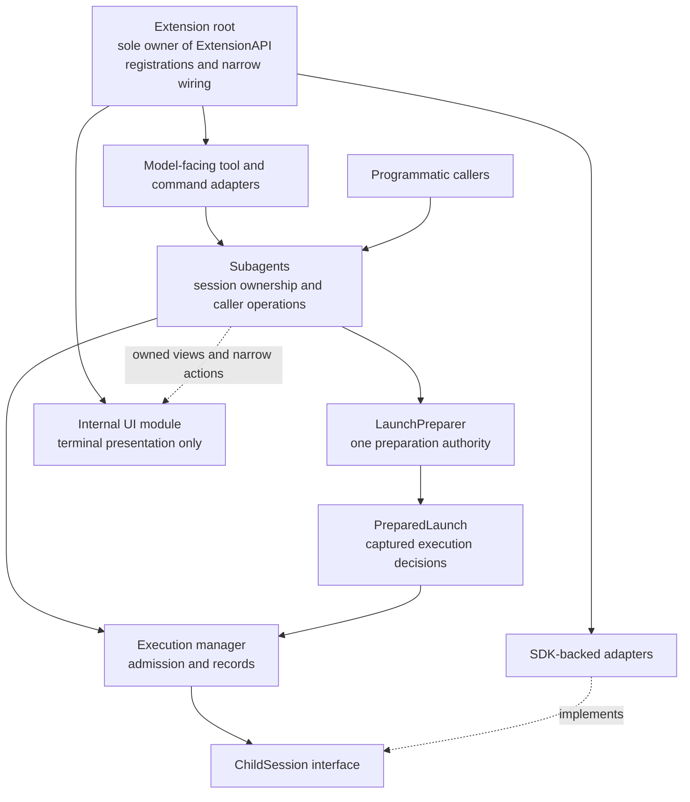

The arrows describe responsibilities and information flow, not a requirement to create a class or file for every box. No module receives a renamed or broadly mirrored Pi facade.

## User Stories

### Ownership and testable handlers

1. As a maintainer, I want the live `ExtensionAPI` instance confined to the extension root, so that Pi coupling is visible and reviewable in one place.
2. As a maintainer, I want registrations and narrow host adaptation at the root, so that implementation modules do not register themselves through hidden host access.
3. As a maintainer, I want focused SDK-aware adapters outside the root, so that SDK construction does not turn the root into a large implementation module.
4. As a developer, I want tool handlers to consume one shared caller-facing interface, so that they do not coordinate the runtime, settings, registry, and manager independently.
5. As a developer, I want handlers to accept accurate local input types, so that invalid test fixtures cannot pass by casting an unknown context.
6. As a maintainer, I want package-owned structural contracts across seams, so that concrete foreign classes with private fields do not leak across packages.
7. As a developer, I want pure helpers to remain functions where appropriate, so that the refactor does not replace simple computation with shallow classes.
8. As a maintainer, I want one owner for each mutable lifetime, so that initialization and cleanup are not scattered across unrelated callbacks.
9. As a maintainer, I want architecture rules checked automatically, so that later human or model-assisted edits cannot quietly reintroduce coupling.

### Authoritative preparation and captured inputs

10. As a caller, I want tool and programmatic launches to use the same preparation authority, so that equivalent requests produce equivalent execution decisions.
11. As a maintainer, I want the existing useful resolver retained behind preparation, so that working routing and reasoning logic is not rewritten unnecessarily.
12. As a caller, I want preparation to produce a complete plan or an explicit rejection, so that execution does not reinterpret partially resolved inputs.
13. As a user, I want an accepted launch to keep its complete selected definition, so that later edits cannot mix new instructions with old capabilities.
14. As a user, I want disabling or deleting a definition to affect future requests only, so that already accepted work changes only through explicit cancellation.
15. As a caller, I want parent inputs captured at invocation before asynchronous preparation yields, so that later model, thinking, tool, or session changes do not alter my request.
16. As a maintainer, I want one capture operation instead of public live-context access, so that callers cannot independently read inconsistent slices of parent state.
17. As a caller, I want a missing active parent session represented as an expected rejection, so that the implementation does not rely on a non-null assertion.
18. As a developer, I want preparation to avoid SDK session allocation, so that queued or rejected requests do not allocate child resources prematurely.
19. As a user, I want the parent working directory and applicable prompt/conversation inputs captured for a launch, so that queued work remains attached to the request that created it.
20. As a maintainer, I want copied owned values rather than mutable shared references in plans, so that readonly annotations are backed by actual mutation isolation.
21. As a caller, I want acceptance to transfer ownership to the session runtime, so that background execution does not depend on the caller staying alive.
22. As a developer, I want the acceptance commit to validate session lifetime and cancellation without an intervening asynchronous gap, so that stale requests cannot create orphaned records.
23. As a maintainer, I want filesystem snapshot limitations stated honestly, so that stable loaded inputs are not mistaken for an atomic transaction across files.

### Definitions, layers, and diagnostics

24. As an operator, I want shipped, global, and project definition layers preserved, so that existing customization workflows continue to work.
25. As an operator, I want not specified, explicit, cleared, and empty values to remain distinct, so that small overrides retain their intended meaning.
26. As an operator, I want lists replaced rather than concatenated, so that a restrictive tool override cannot accidentally widen capabilities.
27. As an agent author, I want empty instruction bodies to inherit and nonempty bodies to replace, so that configuration-only overrides remain concise.
28. As a developer, I want definition loading separated from pure merging and selection, so that I/O and policy can be verified independently without multiplying caller-facing seams.
29. As a caller, I want an immutable definition catalog for each preparation, so that another request cannot mutate definitions during my selection.
30. As an operator, I want definitions refreshed for new launch requests without a watcher subsystem, so that file edits are picked up without adding hidden long-lived resources.
31. As an operator, I want a malformed requested definition to reject explicitly, so that invalid recognized fields do not silently become inherited defaults.
32. As an operator, I want duplicate identifiers for a requested agent treated as invalid, so that filesystem enumeration order cannot select a winner or a fallback.
33. As a user, I want unrelated valid agents to remain usable when one definition is invalid, so that a local configuration error does not unnecessarily stop all delegation.
34. As an operator, I want diagnostics to identify the agent, source, and problem, so that I can repair configuration without parsing generic exception text.
35. As a user, I want unknown and disabled agents rejected rather than redirected, so that the runtime never substitutes a different role.
36. As a maintainer, I want extension-owned trust inputs, checks, and rejection paths removed, so that subagent code does not duplicate Pi's trust responsibility.
37. As a user, I want configured global and project layers loaded normally while the extension runs, so that this extension does not add a second trust gate.

### Models, reasoning, and capability tools

38. As a user, I want explicit exact model identities and the established family-ladder routing preserved, so that architecture changes do not reintroduce fuzzy or price-based model selection.
39. As a caller, I want resolved model and reasoning decisions captured once, so that an accepted request cannot silently reroute later.
40. As a developer, I want owned model identities and reasoning capabilities in the core, so that routing does not retain a live SDK model registry.
41. As a maintainer, I want an SDK adapter to translate model availability and reasoning support, so that SDK-specific details are localized and tested.
42. As a user, I want a selected model that can no longer run to fail explicitly, so that execution never substitutes another identity after acceptance.
43. As a user, I want Pi-compatible reasoning clamping and truthful not-applicable reporting preserved, so that the refactor does not change the established reasoning rules.
44. As a user, I want the retained-parent fallback never to increase reasoning effort, so that delegation does not become more expensive through fallback.
45. As a caller, I want inherited active tools and registered names captured at invocation, so that later parent changes cannot widen accepted work.
46. As a caller, I want MCP wildcard patterns expanded against those captured registered names, so that a prepared plan contains exact capability names rather than deferred patterns.
47. As a user, I want scheduling and child creation to use the same exact capability allowlist, so that workspace classification cannot disagree with permitted tools.
48. As a user, I want recursion exclusions preserved across SDK registry rebuilds, so that inherited extensions cannot re-enable delegation in a child.
49. As a user, I want ordinary missing-tool behavior preserved, so that extraction does not invent a special mandatory web-tool prerequisite.
50. As a maintainer, I want credentials, live SDK objects, and provider internals excluded from prepared/public values, so that records remain safe and implementation-independent.

### Turn policy and settings

51. As a caller, I want request, definition, and operator turn-limit precedence resolved once, so that child-session creation cannot restore a discarded fallback.
52. As a caller, I want deliberately unlimited distinct from not specified, so that an unlimited request is never accidentally limited downstream.
53. As a user, I want the wrap-up allowance captured with the turn ceiling, so that queued work keeps its complete accepted turn policy.
54. As a maintainer, I want final turn policy to contain no unresolved default state, so that the session only enforces a decision rather than making another one.
55. As a user, I want later default-budget changes to affect future launches only, so that accepted work has a predictable budget.
56. As a user, I want child-shaping settings captured with the launch, so that queued children do not gain a different prompt policy, extension exclusion list, or update tool.
57. As a user, I want concurrency, interrupt policy, and retention windows to remain live, so that operational controls apply without rebuilding children.
58. As a maintainer, I want the shared settings store to remain the only backend, so that new interfaces do not create another configuration system.
59. As an operator, I want per-family profile replacement and global/project layering preserved, so that the refactor does not change profile meaning or duplicate operator data into project settings.

### Caller operations, admission, and resume

60. As a programmatic caller, I want asynchronous launch acceptance, so that configuration loading need not block the host event loop through synchronous filesystem work.
61. As a caller, I want accepted and rejected launch results explicitly distinguished, so that ordinary failures do not require parsing exceptions.
62. As a caller, I want acceptance to mean the manager owns an identified child, so that I do not confuse an accepted request with successful execution.
63. As a caller, I want launch acceptance not to await queue capacity or SDK session creation, so that background handoff stays responsive.
64. As a caller, I want an explicit run operation that waits for a settled outcome, so that foreground behavior is not an ambiguous boolean on an ID-returning method.
65. As a maintainer, I want launch and run to share preparation and execution, so that foreground delivery does not become a second orchestrator.
66. As a user, I want the model-facing background/foreground controls translated to the shared operations, so that familiar tool workflows remain available.
67. As a user, I want one concurrency cap applied to every initial and resumed run, so that waiting for a result does not grant extra execution capacity.
68. As a maintainer, I want public queue-bypass exemptions removed, so that the concurrency setting expresses a reliable admission rule.
69. As a user, I want one potentially file-changing child per shared workspace preserved, so that overlapping edits remain serialized independently of result delivery.
70. As a user, I want read-only children able to overlap subject to concurrency capacity, so that serialization remains capability-based rather than role-based.
71. As a user, I want shell and unknown capability tools treated as file-changing, so that an unclassified tool cannot bypass the exclusive slot.
72. As a caller, I want resume dispatched before new-launch preparation, so that continuing an existing child does not require resolving an unrelated new definition or model.
73. As a user, I want resume to retain the child's captured configuration, so that continuation does not silently adopt later defaults.
74. As a user, I want every resume to get a fresh turn counter under the captured policy, so that the new run has its own complete allowance.
75. As a caller, I want existing resume refusal and admission logic centralized, so that tools and programmatic callers decline the same ineligible resumes.
76. As a maintainer, I want breaking public changes documented and versioned deliberately, so that obsolete spawn semantics are not accidentally preserved or silently changed.

### Cancellation, delivery, and lifetime

77. As a caller, I want a launch signal to cancel preparation before acceptance, so that abandoned preparation creates no child record.
78. As a caller, I want a launch signal detached after acceptance, so that accepted background work is not killed by a short-lived caller.
79. As a caller, I want explicit cancellation by ID after acceptance, so that background execution has a clear control operation.
80. As a caller, I want cancelling run to stop its queued or running child, so that foreground cancellation cancels the work it owns.
81. As a caller, I want cancelling or timing out wait to stop observation only, so that a result query cannot accidentally terminate background work.
82. As a user, I want stopped records to remain queryable under normal retention/resume rules, so that cancellation is not confused with deletion.
83. As a user, I want session replacement to cancel and clean up that parent's accepted children, so that old work cannot leak results into a new parent.
84. As a user, I want a cancelled session-switch attempt to leave current work intact, so that tentative navigation does not destroy accepted work.
85. As a caller, I want preparing requests rejected when their parent session ends, so that asynchronous preparation cannot attach old work to a successor session.
86. As a maintainer, I want old notification delivery stopped before cancellation produces outcomes, so that shutdown does not send stale or cross-session nudges.
87. As a user, I want cleanup awaited and idempotent, so that child extensions, timers, subscriptions, and SDK resources do not outlive their owner.
88. As a user, I want hung child shutdown bounded while disposal still proceeds, so that one extension cannot indefinitely block parent cleanup.
89. As a user, I want foreground outcome claiming established before execution can settle, so that a fast completion does not produce duplicate delivery.
90. As a caller, I want result waits associated with the run they began observing, so that a concurrent resume cannot replace the result underneath a waiter.
91. As a maintainer, I want notification delivery and persistence policy preserved except for the explicit lifetime changes, so that structural work does not invent another protocol.

### Extracted terminal presentation

92. As a maintainer, I want all terminal presentation in a separate module inside the pi-tiered-subagents project, so that execution modules contain no TUI implementation.
93. As a user, I want the runtime to load and register the internal UI module, so that extraction does not require enabling a second independent extension.
94. As a maintainer, I want the runtime to adapt to UI-owned contracts, so that the UI module never imports execution implementation.
95. As a developer, I want UI-owned narrow view/action contracts, so that presentation can be tested without a live manager or SDK child.
96. As a user, I want the widget, transcript viewer, and settings views preserved, so that architecture improvement does not remove useful workflows.
97. As a maintainer, I want tool-result and notification renderers moved with the other terminal presentation, so that rendering knowledge is not split across packages.
98. As a developer, I want transcript reading behind a focused adapter, so that the viewer never receives a live child session.
99. As a maintainer, I want removing presentation consumers not to change execution decisions or outcomes, so that headless behavior remains independently functional.
100. As a maintainer, I want model-facing text and outcome-delivery policy distinguished from terminal rendering, so that a UI library does not become an execution dependency.

### Modern TypeScript, APIs, and verification

101. As a developer, I want discriminated unions and exhaustive handling for semantic alternatives, so that adding a new outcome produces compiler guidance at its consumers.
102. As a developer, I want literal-preserving configuration checks with satisfies, so that tables are validated without losing useful inference.
103. As a developer, I want readonly owned values and copy isolation for snapshots, so that type-level immutability is not mistaken for protection from external mutation.
104. As a developer, I want indexed reads checked for absence, so that a missing tier, queue entry, or catalog lookup cannot become an unchecked assumption.
105. As a developer, I want exact optional-property semantics, so that omission is not silently equated with an explicitly supplied undefined value.
106. As a developer, I want external data validated from unknown once at its entry seam, so that the core consumes valid owned types instead of repeatedly interpreting raw JSON.
107. As a maintainer, I want new I/O to use asynchronous APIs at its adapters, so that legacy synchronous call chains do not expand into the new architecture.
108. As a developer, I want promise and cancellation APIs used according to their actual semantics, so that modernization simplifies mechanics without changing ownership.
109. As a maintainer, I want lexical resource-management syntax used only after loader/runtime compatibility is verified, so that source-shipped packages do not break under Pi.
110. As a developer, I want typed tool definitions and structured outputs for genuinely structured data, so that programmatic consumers do not parse display text.
111. As a maintainer, I want modern public SDK operations preferred over implementation-detail access, so that upgrades require fewer concrete-class assumptions.
112. As a developer, I want most behavior tests to cross the Subagents interface, so that the test surface stays small and survives internal refactors.
113. As a developer, I want a controllable ChildSession adapter, so that tests can pause, settle, fail, steer, and cancel execution deterministically.
114. As a maintainer, I want focused real offline SDK checks, so that recording mocks are not mistaken for proof that actual binding and tool activation work.
115. As a developer, I want UI contract tests based on owned views and actions, so that presentation can be extracted without copying lifecycle tests into another package.
116. As a maintainer, I want behavioral and architecture checks rather than class-shape assertions, so that improvements are not blocked by inherited implementation tests.
117. As a maintainer, I want verification run through workspace Nx targets, so that the project and affected siblings respect the repository's tooling policy.

### Independent ownership and migration cleanup

118. As a maintainer, I want this workspace to be the maintained implementation, so that development no longer relies on the migration clone.
119. As a maintainer, I want the identified temporary local clone removed after safe verification, so that migration scaffolding does not remain as an accidental dependency.
120. As a maintainer, I want only that verified local clone removed, so that no remote repository, unrelated checkout, or migrated package is deleted.
121. As a user, I want the README to credit the immediate fork source and upstream lineage, so that the project's origin is publicly clear.
122. As a maintainer, I want applicable MIT notices preserved, so that independence does not erase licensing obligations.
123. As a developer, I want locally owned architecture and updated glossary/decision records, so that upstream historical snapshots are not mistaken for current requirements.
124. As a maintainer, I want intentional behavior changes separated from reproduced bug fixes, so that review does not confuse architectural decisions with unverified defect claims.
125. As a maintainer, I want targeted modernization rather than a second broad rewrite, so that advanced language features earn their place through concrete correctness or maintenance benefits.

## Implementation Decisions

### 1. Authority, compatibility, and preserved product behavior

- Implement the approved interview decisions, including the final explicit removal of extension-owned trust logic. Do not implement the earlier proposed trust-revalidation branch; it was rejected.
- Preserve the five shipped specialists, definition layering vocabulary, exact model selection, family ladders, reasoning policy, parent identity/conversation rules, child-parent communication, workspace provision, result retrieval, and established notification/persistence behavior except where this specification explicitly changes them.
- Preserve the request-over-definition precedence and one standing-instruction shape. Do not restore model locks, prompt modes, recursive delegation, fuzzy matching, or price-ranked routing.
- Keep the shared settings store as the only backend. Preserve per-setting operational layering, whole-family profile replacement, and separation of operator-owned data from project overrides.
- Breaking programmatic changes are allowed and required where specified. Do not retain a synchronous ID-only spawn contract or public concurrency-bypass option merely for inherited compatibility. Document migration and select versioning according to repository release policy; no particular release number is prescribed here.
- Familiar model-facing tool names and useful workflows remain unless a separately justified change is necessary. Do not redesign the model-facing interface simply because programmatic redesign is permitted.
- Reconcile the accepted decisions on workspace scheduling, settings, and background execution: retain their substantive product rules, but explicitly supersede foreground limiter bypass and extension-owned trust clauses. Preserve historical evidence rather than rewriting it to pretend the new design always existed.

### 2. Extension root, modules, and seams

- The live `ExtensionAPI` instance, its type reference, and Pi registrations belong only to the runtime extension root. SDK-aware adapters may import other relevant public SDK types and constructors without receiving that instance.
- The root constructs collaborators and supplies narrowly scoped callbacks, such as publishing a particular event or executing a shell operation. Do not hand an entire event bus to a handler that needs one publishing operation.
- Do not replace Pi with a broad facade, a Pick-shaped copy of the host interface, a global host accessor, or a service locator that recreates the same coupling under a different name.
- The session-scoped `Subagents` module owns caller operations, session validity, acceptance, and by-value query results. Both tool adapters and programmatic callers use it. Tool adapters do not independently consult the runtime, registry, or settings.
- `LaunchPreparer` owns preparation, not scheduling, rendering, SDK session allocation, or notification transport. Reuse the existing shared resolver and useful family strategies behind it.
- The manager owns admission, tracked records, cancellation, retention, and execution coordination. It consumes prepared decisions; it does not reload definitions or merge launch defaults again.
- Retain useful stateful run/session objects and pure computation. The names in this specification designate responsibilities, not a mandatory one-class-per-name structure.
- Launch/lifecycle policy consumes package-owned data and structural interfaces. SDK-specific session construction and terminal integration belong to focused adapters; do not leak concrete foreign classes with private fields in exported type surfaces.

### 3. Capture, loading, and the acceptance commit

- Capture current parent model identity/capabilities, reasoning effort, active capability names, registered names used for expansion, working directory, session identity, portable prompt inputs, and relevant conversation data at invocation, before the first asynchronous yield. Capture launch-shaping settings at that point as owned values.
- Definition loading may then perform asynchronous I/O and produce an immutable merged catalog. Each preparation selects from its own stable loaded snapshot. A new request refreshes definitions; no watcher/cache subsystem is required.
- Preserve the difference between a parent snapshot, a definition catalog, and a prepared launch: they describe parent facts, loaded definitions, and resolved execution respectively. None carries a live SDK registry.
- The session owner issues an internal generation token with the parent capture. Before acceptance, validate that generation and preparation cancellation are still current. The final validation, record registration, and ownership transfer must not contain an await-sized gap.
- An accepted result has a stable child identifier and a manager-owned record. Rejected preparation has no accepted child record, SDK session, or workspace allocation. Internal preparation bookkeeping may exist but must not masquerade as an accepted child.
- Awaiting acceptance does not wait for global admission, the workspace slot, SDK construction, or execution completion.
- A copied snapshot is not an atomic filesystem transaction. Concurrent multi-file edits may affect what one asynchronous read observes; do not promise stronger filesystem consistency or invent a transactional configuration store.

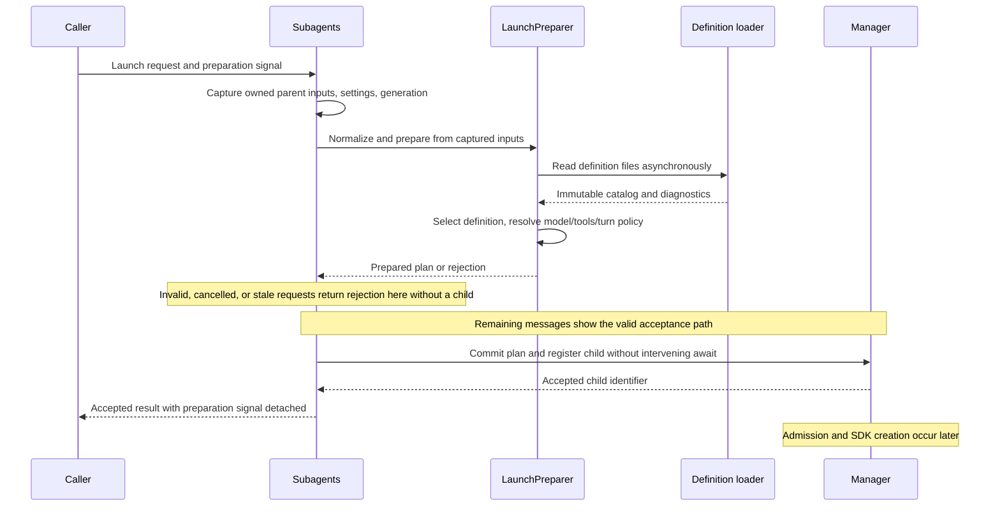

### 4. Prepared launch and immutable catalogs

- A prepared launch contains the selected definition by value, including instructions and effective defaults; exact normalized capability names; captured parent inputs; model and reasoning decisions; final turn policy; and child-shaping settings needed by construction. Separate execution facts from caller-specific delivery policy rather than retaining an ambiguous foreground configuration mechanism.
- Definition edits, disabling, or deletion affect subsequent requests only. Explicit cancellation controls already accepted work. Session lifetime remains an execution prerequisite, but ordinary file changes do not invalidate a captured launch.
- Readonly properties and readonly collections express the interface. Copy nested mutable inputs where required so the implementation actually provides mutation isolation. Neither readonly nor const assertions perform runtime freezing.
- The definition catalog produces available, unknown, disabled, or invalid selection outcomes. Retain normalized identifiers and distinct display names.
- Validate recognized fields rather than treating invalid values as absent. Explicit null/cleared and empty-list values retain their documented meaning. Unknown metadata may remain ignored; it is not an invitation to evaluate code.
- Invalid/duplicate definitions invalidate the affected requested identifier instead of falling back to a shipped/default definition. Other valid identifiers remain usable when the error can be attributed. An unreadable whole scope must not be misrepresented as a confidently empty or valid scope; report the inability to establish applicable configuration explicitly.
- Diagnostics carry an owned category, applicable identifier, source information, and human-readable explanation. They must not require consumers to parse message strings into control flow.

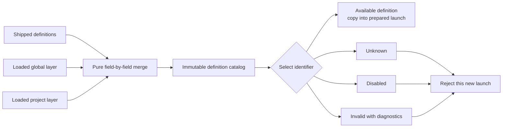

### 5. Models, reasoning, tools, and prompt assembly

- The model-catalog adapter captures exact identities, available candidates, and SDK-reported reasoning capabilities into owned values. Use public model-resolution and reasoning-support APIs. Credentials, mutable registries, and concrete SDK model/session objects remain inside integration implementation.
- Preserve exact explicit choice and family-ladder selection, unknown-family rejection, known-family exhaustion behavior, and declaration-driven cross-version links. Do not rebuild routing as part of this refactor.
- Preserve Pi-compatible thinking-level clamping. Translate SDK behavior into owned capability data or a narrow compatibility adapter, with differential/contract verification against public SDK helpers. Do not silently replace clamping with a new independent ranking algorithm to satisfy an import rule.
- Preserve the default medium/low/lowest-supported-non-off order, non-reasoning not-applicable state, explicit-off policy for reasoning models, and no-increase rule for retained-parent fallback.
- Materialize the exact accepted identity in the SDK adapter. Later provider or availability failure is an execution failure, not permission to select another model. Do not let SDK implicit default/fallback behavior silently undo this invariant.
- Resolve inheritance and expand MCP patterns against the registered names captured at invocation. The prepared launch contains exact capability names, with management tools excluded. The same list drives workspace classification and SDK allowlisting.
- Exact allowed names do not freeze implementation binaries, guarantee third-party tool availability, or constitute a sandbox. Preserve ordinary missing-tool behavior; do not add a special web prerequisite or silently widen capabilities to compensate.
- Protocol tools such as ask-parent and permitted mid-run updates remain distinct from capability tools. Their installation does not authorize recursive delegation or alter read-only/file-changing classification.
- Assemble environment- and child-directory-specific prompt/resource contributions at execution, using captured definition/identity policy and the actual prepared workspace. Do not preallocate the SDK session or claim to freeze the filesystem. Preserve the child's own tool guidance and exclusion of parent-only orchestration/harness text.

### Role-aware model selection follow-up (issue #10)

The existing model-selection seam receives the resolved definition identifier;
request pin, then definition pin, then automatic routing remains the precedence.
No new launch authority or reroute-after-acceptance path is introduced.

Automatic routing uses the resolved agent identifier and the family profile's
required `group`:

| Agent | Size group (`gpt`, `claude`, `qwen`) | Planner/worker group (`gemini`, `minimax`, `glm`, `mimo`, `deepseek`) |
| --- | --- | --- |
| `worker` (general-purpose work) | One size below the parent, clamped at S | worker |
| `researcher` | S | worker |
| `debug` | M | worker |
| `reviewer` | Equal: the parent's own size | planner |
| `explore` | S | worker |

Custom identifiers use worker behavior; this does not add a sixth shipped role.
The mapping is shipped policy, not operator-configurable settings.

Size assignments are Qwen max = L, plus = M, flash = S; Claude opus = L,
sonnet = M, haiku = S; GPT sol and astra = L, pro/luna/terra = M, mini/nano = S.
Dated snapshots use the size of the tier they belong to.

A size or class target starts at the top matching rung in the parent's version;
Equal starts at the parent's own rung, not the top of its size. If that version
has no matching target, only profile-approved cross-version links may reach it.
From the resolved target, try concrete IDs in preference order, then cheaper
rungs in the same version, then approved cross-version links, skipping anything
the session cannot run. No version relationship is inferred. If nothing is
runnable (including an absent target class), keep the parent's model and report
why. A reviewer retaining its own rung by Equal is a designed choice, not an
exhaustion fallback. The launch reason names the role and target as well as the
chosen model, including retained outcomes.

Flash-named tiers, including the separate flash-lite rung, are worker class;
pro/non-flash flagship tiers are planner class. These are profile labels, not
runtime name-based classification. MiniMax M3.1-flash is the new worker rung
below its planner flagship; M3 and M2.7 have approved links to that flash rung.
This is **MiniMax 3.1 flash, not Gemini 3.1 flash**. Flash-only Gemini 3.x
versions have approved links to the 2.5 pro planner rung, and Qwen 3.7 has an
approved path to 3.6 flash for S. DeepSeek has planner but no worker class:
reviewer targets pro, and the other roles retain the parent.

GLM uses a glued-version naming strategy (version adjoining the prefix,
variants following it) and a planner/worker profile. Kimi is no longer a
supported automatic-routing family: a Kimi parent requires an explicit model.
The shipped catalogue is representative of the installed SDK, not a promise of
vendor availability. Profiles enumerate candidates; session access decides
which can run. Model routing changes neither exact-pin resolution nor reasoning
selection.

A replacement must declare `group: "size"` or `group: "planner-worker"`.
Every tier in a size profile requires `size: "S" | "M" | "L"`; every tier in a
planner/worker profile requires `class: "planner" | "worker"`. Invalid or missing
labels are reported when read, not silently inferred. Upgrade existing whole
replacements by adding these labels; version/tier/model/fallback shape and
whole-family replacement semantics stay the same. Examples are representative
profile data, not provider-access guarantees.

### 6. Turn policy and captured versus live settings

- Resolve request, captured definition, then captured operator-default precedence exactly once. Preserve documented minimum-turn normalization. Represent a deliberately unlimited decision distinctly from an omitted input.
- Final turn policy is a closed limited/unlimited alternative with the applicable wrap-up allowance. It contains no unresolved fallback. If a wrap-up value is irrelevant for an unlimited policy, do not manufacture a warning phase for it.
- Child-session construction enforces this decision without reading another default. Resume keeps the policy but starts a fresh counter.

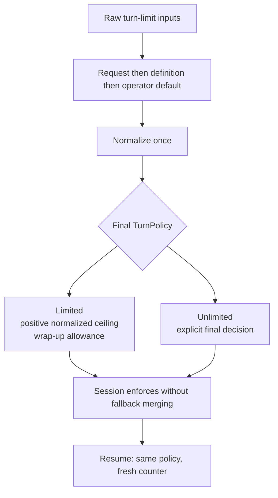

| Setting or input | When read | Changes after acceptance |
| --- | --- | --- |
| Selected definition and instructions | Preparation catalog selection | Future requests only |
| Parent identity/model/effort/tools/conversation | Invocation capture | Future requests only |
| Resolved model/reasoning and profile-derived decisions | Preparation over captured inputs | Never reroute accepted work |
| Turn ceiling and wrap-up allowance | Preparation | Future requests only |
| Mid-run-update protocol-tool availability | Invocation/preparation capture | Future launches only |
| Prompt-inheritance policy | Invocation capture | Future launches only |
| Excluded extension-package list | Invocation capture | Future launches only |
| Concurrency cap | Admission/recheck | Applies to queued/new admissions; no implicit killing of active work |
| Abort-all-on-parent-interrupt | At interrupt | Current policy applies |
| Retention windows | Retention evaluation | Current policy applies |
| Session generation/lifetime | Invocation, commit, and execution ownership | Ended owner cannot accept or keep work |

- These are two read contracts over the same settings module, not two backends. A synchronous third-party storage contract may remain synchronous inside its adapter; do not invent asynchronous wrappers that pretend its I/O became nonblocking.

### 7. Programmatic operations and outcome semantics

- Provide asynchronous `launch` acceptance and an explicit `run` operation for settled execution. Exact request/result type names beyond the agreed concepts can follow local conventions; semantics are normative.
- Launch resolves to accepted with a child identifier, or rejected with a structured expected reason. Expected reasons cover unavailable/invalid requested configuration, unknown/disabled agent, absent/ended session, and cancellation where applicable. Unexpected implementation failures remain exceptions; do not catch every exception and disguise it as a normal rejection.
- Acceptance is not execution success. Post-acceptance SDK construction failures appear on the accepted child's run/record and can be observed normally.
- Run uses the same preparation, acceptance, and execution path. It adds caller-owned waiting, progress, and delivery claiming, established before a fast run can finish. Do not implement run as an unprotected launch-then-claim race.
- Progress crosses the caller interface as owned snapshots/updates, not SDK events, live records, or subscriptions exposing implementation objects. Do not duplicate every low-level SDK event into a new public bus.
- Keep by-value query results. Maintain the existing separation between stable record facts and live activity/transcript views. Public results must not expose mutable manager, Subagent, ChildSession, SDK session, credential, or provider-registration objects.
- Resume is a distinct operation dispatched before new-spawn preparation. It uses centralized eligibility/admission, retains its existing child configuration, accepts a new prompt, and starts a fresh run counter. This refactor adds no model/budget reconfiguration on resume.
- Preserve the result-wait guarantee that a waiter observes the run it started waiting for, even if resume subsequently replaces the current run. Preserve revocable per-carrier delivery claims and consumption semantics rather than rewriting that machinery blindly.
- Root publication/discovery must expose only a valid active-session owner. A retained reference to an ended owner must reject instead of being silently rebound to a later session. No new global SDK registry or independent UI service-discovery protocol is required.

### 8. Admission, workspace impact, and cancellation

- Every initial and resumed run, whether launched or awaited through run, enters the same live concurrency limiter. Remove foreground exemptions and public bypass capability.
- Preserve FIFO/admission behavior where established. A reduced cap prevents additional admissions until capacity permits; it does not implicitly abort already active runs.
- Preserve the independent exclusive workspace slot based on exact effective capability names. Known readers are read-only; shell, editors, and unknown names are file-changing. Readers overlap subject to concurrency capacity. The workspace slot is held for a run, not during preparation or while waiting for a concurrency slot.
- Keep the workspace-gate registry at the scope needed to coordinate session-owned managers for the same originating working directory. A new manager must not accidentally create a conflicting writer slot while the old owner is cleaning up.
- A resumed run uses its captured capabilities and the established workspace rule. Workspace provision remains separate from execution and does not become an isolation guarantee.

| Operation | Caller signal before acceptance | Caller signal after acceptance | Timeout/observation behavior |
| --- | --- | --- | --- |
| `launch` | Cancel preparation; reject without a child record | Detached; use explicit cancellation by ID | Acceptance does not wait for capacity/completion |
| `run` | Cancel preparation | Stop that queued/running execution | Settles with the appropriate run outcome after cleanup semantics |
| `wait` | Not a new launch | Stop this observation only | Timeout stops waiting, never the child |
| Explicit cancel by ID | Acts only on an accepted child | Stop queued/running execution | Keep the stopped record under normal retention rules |
| Parent-session replacement/shutdown | Invalidate preparation generation | Stop owned children | Suppress stale delivery and await cleanup |

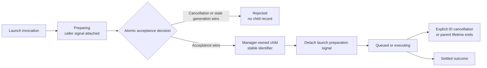

- Check already-aborted signals before starting work. Attach abort listeners safely and release them on every completion/cancellation path; a one-shot listener alone does not clean up a listener whose signal never aborts.
- Timeout, caller cancellation, parent interrupt, session replacement, and provider failure retain distinguishable meanings. Do not flatten every abort reason into a user stop or a turn-budget exhaustion.

### 9. Parent-session ownership, cleanup, and absence of trust policy

- One session-scoped owner holds accepted children, preparing requests, delivery state, and associated cleanup. Do not start retention timers or child resources merely because Pi loads the extension factory without a session.
- A confirmed parent-session replacement ends the old owner: close acceptance, invalidate generations, suppress old notifications, cancel queued/running work, await child cleanup, then release presentation resources. Cleanup is idempotent and does not abandon siblings when one teardown fails.
- A before-switch request is not proof of a committed replacement. Verify the installed SDK lifecycle and preserve work if another handler/user cancels the switch. Do not invent a nonexistent committed-switch SDK event.
- Retain bounded child shutdown followed by SDK disposal, including fallback behavior for handlers that throw, reject, or hang. Do not replace an enforced promise bound with a signal that the hanging operation does not observe.
- Suppress terminal nudges before cancellation triggers terminal transitions. Preserve parent-run delivery gating and outcome claims; never deliver an old parent's result into the next parent's context.
- Remove extension-owned project-trust fields, branches, checks, launch rejection reasons, and tests. Configured global/project definition and settings layers load normally while this extension runs. Remove obsolete extension trust requirements from current documentation.
- Do not force, spoof, or override SDK trust decisions. Ordinary SDK resource/session behavior remains SDK-owned. Removing this extension's direct-file gating does not justify a claim that all direct project reads are protected by a host gate.
- Session generation and operation cancellation are lifetime checks, not a disguised trust policy. No trust watcher, revocation monitor, authorization token, or sandbox belongs in this design.

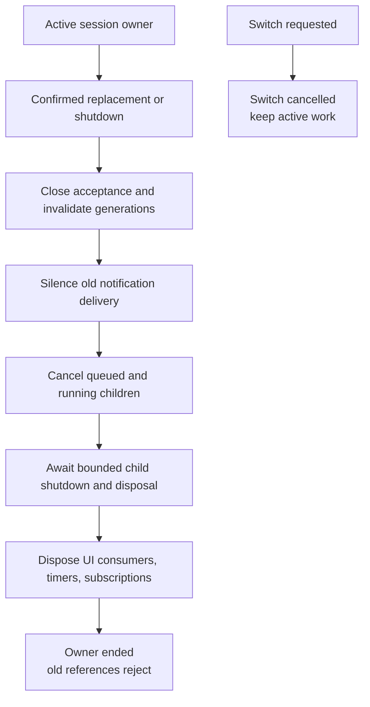

### 10. Internal UI module and dependency direction

- Extract terminal presentation into `src/ui/` within `pi-tiered-subagents`. Do not create a separate workspace/npm package, package manifest, or independently enabled extension. The runtime remains the loaded extension; the UI module must not import execution implementation.
- Move all terminal presentation together: widget and related rendering, transcript viewer, settings views, tool-call/result renderers, notification renderers, and presentation helpers.
- The runtime root retains Pi command/tool/message-renderer registrations and wires the library. The library does not receive ExtensionAPI or register through a hidden host reference.
- The UI module defines small structural views/actions for agent summaries, progress, transcript reading, settings edits, and presentation lifetime. Runtime presentation adapters supply those views. Do not introduce a shared-contracts package.
- Export local/public structural type surfaces, not inferred concrete foreign classes with private fields. SDK/TUI-specific implementation can remain internal to presentation adapters.
- Keep model-facing text, outcome meaning, notification timing/claiming, and persistence policy in the runtime. A terminal renderer may format facts but must not decide routing, turn limits, resume eligibility, or execution status.
- Preserve useful UI behavior rather than redesigning workflows during extraction. Core execution must behave identically with or without presentation consumers. No separate UI service-readiness/event protocol is needed.

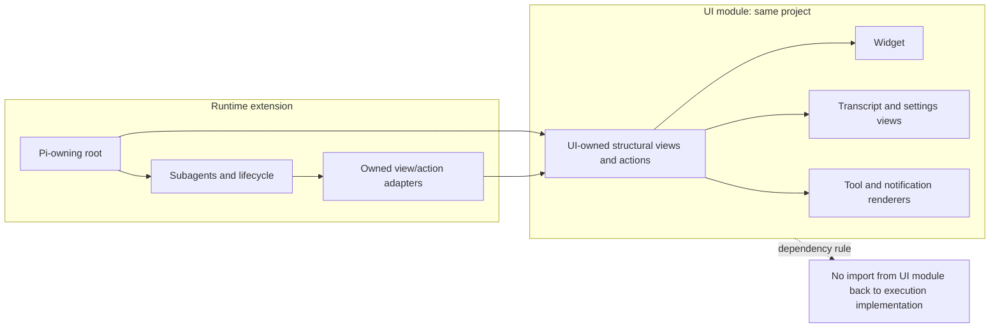

### 11. Required modern TypeScript features

Modernization is normative where it strengthens these seams. It is not permission for an unrelated whole-workspace syntax rewrite. The following table distinguishes requirements from opportunistic mechanisms.

| Feature | Required use in this work | Why it earns its place | Verification |
| --- | --- | --- | --- |
| Discriminated unions | Launch acceptance/rejection, selection diagnostics, final limited/unlimited policy, and other meaningful closed outcomes | Excludes contradictory combinations and supports narrowing | Compile-time and behavior coverage for each variant |
| Control-flow narrowing and exhaustive handling | Closed semantic alternatives that consumers must fully handle | New variants cannot silently inherit a default-success path | Exhaustive switch/never check or complete typed dispatch table |
| `satisfies` | Fixed strategy/profile registries, outcome maps, and typed fixtures where literal inference matters | Validates shape without replacing useful inferred types | Incorrect keys/values fail typecheck |
| `as const` with `satisfies` where appropriate | Fixed literal vocabularies/tables that genuinely need narrow readonly literal inference | Keeps identifiers/discriminants precise | No assertion used to bypass incompatibility |
| `readonly` properties and collections | Owned catalogs, captures, plans, public snapshots, UI views | Communicates immutable use and blocks accidental writes | Mutation-isolation tests prove copy behavior too |
| `unknown` plus runtime validation | Frontmatter, persisted records, JSON settings, and other untrusted-shaped data | Static types cannot validate input bytes | Malformed input produces typed diagnostics at entry |
| Local structural interfaces | ChildSession, model/loader adapters, handler inputs, UI views/actions | Fakes and real adapters cross the same seam without class casts | Production and test adapters typecheck against the contract |
| `Record`/mapped types and ordinary utility types | Complete maps over finite owned vocabularies and deliberate narrow views | Localizes completeness checks without inventing a type framework | Missing required map members fail typecheck |
| `noUncheckedIndexedAccess` | Enable for the runtime and internal UI module, staged as needed | Catalog, ladder, array, and queue reads can be absent | Real handling of absence, not added non-null assertions |
| `exactOptionalPropertyTypes` | Enable throughout the project, staged as needed | Omitted differs from explicitly supplied undefined | Fixtures and builders preserve absent/cleared/empty distinctions |
| Strict typing and unknown catch values | Retain strict mode and strengthen refactored code | Expected rejection differs from arbitrary thrown values | No broad any/unknown-to-concrete escape in core contracts |
| Type-only imports and named exports | Refactored modules, except framework-required default exports such as the Pi factory | Makes dependency direction and public names explicit | Lint/typecheck; no new namespace-based extension framework |

- Choose an interface for ordinary object contracts and a type alias for discriminated unions/intersections where appropriate. Allow inference when it remains accurate; do not annotate every local variable.
- Prefer `as const satisfies` to a plain const assertion when checking a fixed table against a contract. Do not force const assertions onto dynamic data or use assertions as validation.
- Do not solve strictness failures by widening everything to any, adding non-null assertions, or casting through unknown into an SDK class. Any unavoidable SDK compatibility cast must be narrowly contained and justified in the adapter, with an integration check; it cannot leak to caller contracts.
- Use expected compile failures deliberately in type tests with the appropriate compiler expectation mechanism. Do not add blanket suppression comments or relax UI contracts merely to copy inherited debt.
- Literal precision is not an excuse to build recursive conditional types, a custom generic result framework, branded identifiers everywhere, or an open plugin registry without demonstrated demand.

#### Visual: compile-time policy versus runtime validation

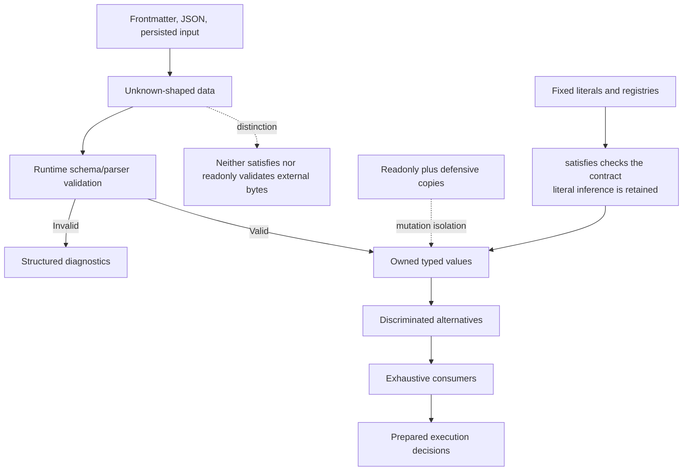

#### Visual: omission is not clearing and neither is an invalid value

| Layer input | Meaning | Required interpretation |
| --- | --- | --- |
| Key absent | Not specified | Inherit the lower layer |
| Valid value | Explicit | Replace the lower layer |
| Supported null | Cleared | Remove the inherited optional choice and use its automatic path |
| Empty list | Empty | Keep an empty capability selection |
| Invalid recognized value | Invalid | Diagnose; do not reinterpret as absence |
| Explicit undefined in an internal builder | Not automatically an omitted optional property | Omit intentionally or model undefined explicitly where truly part of the contract |

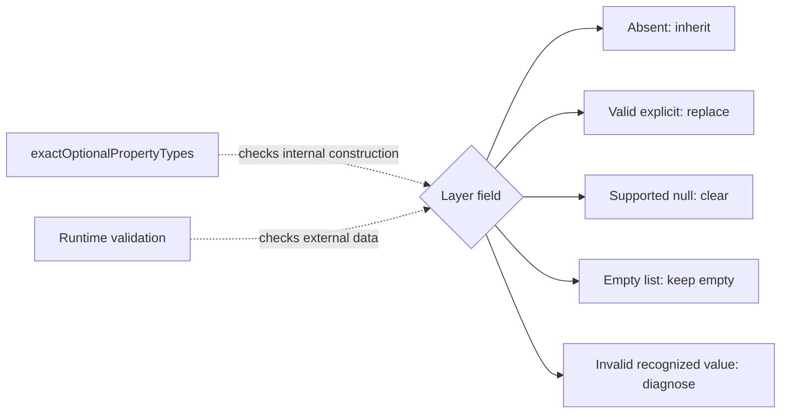

#### Visual: adding an outcome must reveal incomplete consumers

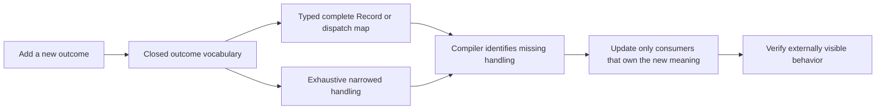

The diagram is a requirement for compiler leverage, not a mandate for a particular helper, class hierarchy, or exhaustive-check library.

### 12. Standard and SDK APIs: mandatory versus conditional adoption

| API or facility | Decision | Where/how it applies | What it must not imply |
| --- | --- | --- | --- |
| Promise-based filesystem APIs | **Required for new I/O seams** | Definition loading and transcript reading use asynchronous adapters; pure parsing stays synchronous | Merely declaring async does not make synchronous third-party storage nonblocking |
| `Promise.withResolvers()` | **Use where a deferred promise is actually needed** | Queue entries and controllable async tests; retain existing clear usage instead of hand-rolled external-resolver boilerplate | No requirement to turn ordinary returned promises into deferred objects |
| `AbortController` / `AbortSignal` | **Required ownership mechanism** | Implement the agreed preparation, execution, observation, and session-lifetime contracts | An abort signal does not force a collaborator to stop unless it observes it |
| `AbortSignal.any()` | **Conditional, preferred over equivalent manual composition when safe** | Combine signals that genuinely govern the same operation, preserving abort reasons and listener lifetime | Never combine the detached launch preparation signal into accepted background execution |
| `AbortSignal.timeout()` | **Conditional for cooperative operations** | Apply a deadline only when the operation observes the signal and semantics match | It is not a bound on an arbitrary hung promise or a replacement for mandatory shutdown progress |
| `Promise.race` with explicit cleanup | **Retain when a non-cooperative await must be bounded** | Bounded child shutdown/observation as required; always release timers and handle late rejection | Winning a race does not cancel the losing operation |
| `using` / `await using`, dispose symbols | **Conditional, not a blanket requirement** | Lexically owned temporary resources/subscriptions only after end-to-end loader/runtime verification | Session-owned resources must not be disposed when a factory/helper returns |
| `DisposableStack` / `AsyncDisposableStack` | **Conditional, same compatibility gate** | Multiple genuinely scope-owned cleanup actions if clearer than existing finally logic | No runtime-wide polyfill or new dependency without a demonstrated need |
| Pi `defineTool` and TypeBox schemas | **Required for refactored tool-definition adapters where applicable** | Preserve inference and validate model-facing input without duplicating schemas by hand | Do not use an SDK helper as a reason to put host access in handlers |
| Tool `outputSchema` and `structuredContent` | **Required for refactored tools that expose genuinely structured data** | Schema-matching accepted/rejected/status/result data alongside model-facing content and rendering details | Not every human message needs a schema; text, details, and structured output must not disagree |
| Public SDK model/reasoning APIs | **Required integration source of truth** | Capture availability/support and preserve Pi-compatible thinking behavior in adapters | Do not independently invent credentials, fallback identities, or reasoning support |
| SDK tool allowlist and `excludeTools` | **Required existing protections** | Apply the prepared exact capability names and recursion exclusions through SDK mechanisms that survive registry rebuilds | A one-time active-tool filter is not equivalent to a persistent denylist |
| Public SDK session/provider lifecycle operations | **Required where supported by the installed SDK** | Construct/bind/replay/dispose through tested adapters using the SDK's actual contracts | Do not replace concrete behavior with a mock and call compatibility verified |

- Expected launch rejection must be represented honestly in the tool adapter, not presented as a successful tool response containing an error sentence. Use the installed SDK's supported error/result mechanism and retain structured data where that mechanism supports it. Accepted execution failure remains a run outcome, not a retroactive pre-acceptance rejection.
- Use source-shipping and actual Pi loading as compatibility constraints. The locally inspected environment is TypeScript 6.0.3, Node 24.18.0, and Pi 1.3.0; the installed Pi package declares Node >=22.19.0. Local availability on Node 24 alone is not sufficient evidence for raising the supported runtime baseline or adopting native syntax everywhere.
- No compiler, Node, Pi, or package-manager upgrade is required merely to satisfy the modernization goal. Verify API/library typings, supported Node behavior, and Pi's TypeScript loader before adopting optional features. Record a concrete compatibility limitation instead of claiming a conditional feature is mandatory.

#### Visual: cancellation composition follows ownership, not convenience

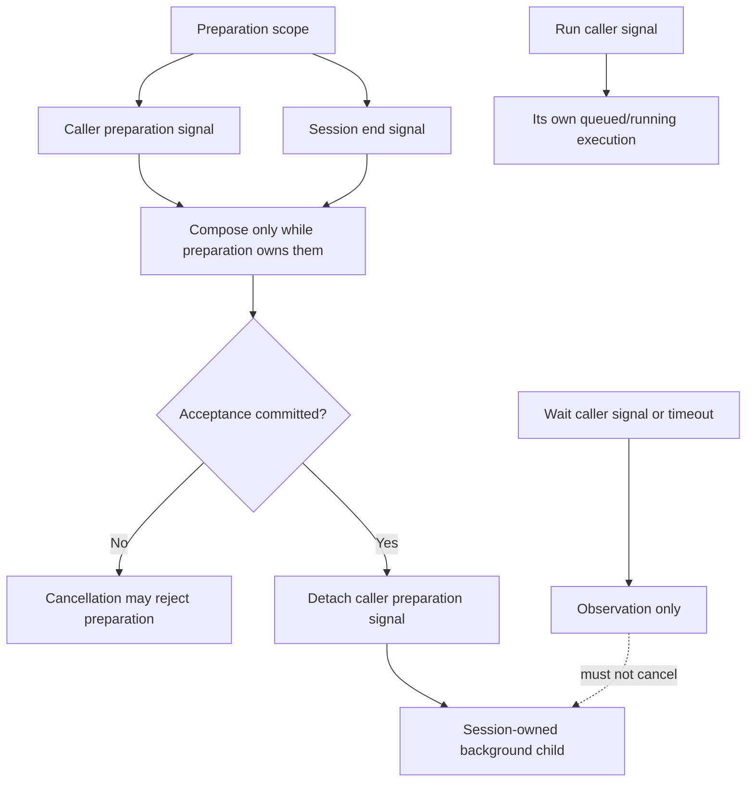

#### Visual: explicit resource management is lexical, session lifetime is not

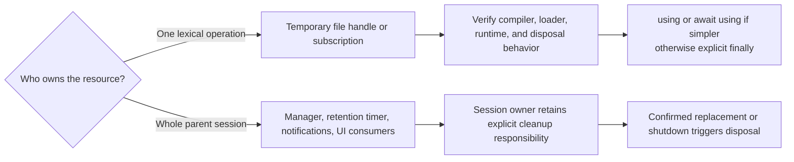

#### Visual: structured tool output is not terminal rendering

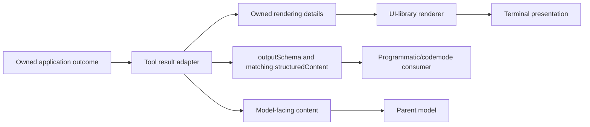

### 13. Tooling, package policy, and architecture checks

- Stay on main unless the maintainer requests another branch. Keep the UI module inside the existing project: no package scaffolding, workspace dependency, or independent Pi registration is needed for presentation.
- Keep root-managed dependency versions, source shipping, Nx targets, and the repository's module-dependency policy. Do not add package-level scripts or duplicate shared Pi development dependencies.
- Any unrelated workspace dependencies must still be linked through the package manager, not hidden behind TypeScript path aliases.
- Enforce root-only ExtensionAPI use, SDK-constructor/type isolation from policy modules, one-way runtime-to-UI-contract dependencies, no presentation implementation in execution, and owned exported interfaces. Use targeted ESLint/Nx rules and focused architecture checks as appropriate.
- Checks must encode semantic dependency rules rather than exact class names, constructor order, historical filenames, line counts, or the number of modules. Moving an SDK adapter should not fail a test merely because its old location disappeared.
- Narrow inherited lint exemptions as the affected code is replaced. Do not spread the old any/non-null exemptions to new UI contracts.

### 14. Incremental delivery, provenance, and clone removal

- Implement in reviewable increments: establish the shared behavior contracts, introduce authoritative preparation/session ownership, adapt execution, extract UI, strengthen TypeScript/dependency rules, reconcile documentation, then verify cleanup. Separate intentional semantic changes from structural moves and from independently reproduced bugs.
- Retain useful characterization tests throughout migration. Replace redundant tests of private structure only when equivalent or stronger behavior coverage exists; do not delete the regression suite wholesale.
- Record locally owned architecture and glossary vocabulary. In particular, parent snapshot no longer means a live model registry; use the established agent definition, layer, identifier, reasoning level, workspace impact, exclusive slot, and profile vocabulary consistently.
- Retire reliance on the temporary migration clone, not the source provenance. Keep README credit naming the immediate source `@gotgenes/pi-subagents` v25.0.1, its `@tintinweb/pi-subagents` lineage, and applicable MIT notices.
- Remove only the verified temporary local clone after confirming identity, absence of unique uncommitted work, and that source/tests/docs no longer depend on its location. Verification must succeed independently of that clone. Do not delete or archive any GitHub repository, remove the migrated package, or erase attribution.
- Do not remove sibling packages' upstream compatibility dependencies as collateral cleanup; they are separate integrations, not this runtime's migration clone.

## Testing Decisions

### Confirmed primary seam

The maintainer already approved the shared session-scoped `Subagents` interface as the highest behavior-test seam and the internal `ChildSession` interface as the execution substitution point. **Do not reopen that interview.** Most scenarios exercise the same operations used by tool/programmatic callers, with real preparation/resolution/manager logic and controllable I/O/session adapters. Avoid creating one external test interface per class.

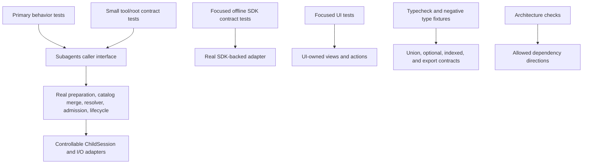

### What makes a good test

- Assert externally observable acceptance/rejection, exact prepared behavior realized by the child adapter, run outcomes, records/events, progress, cleanup, and presentation. Do not assert that a runtime is a class, a factory returns an instance of that class, or a specific private helper was called.
- Use controllable promises and explicit state transitions rather than arbitrary sleeps. A fake clock may drive a real deadline or retention rule; do not preserve obsolete timing assumptions from historical tests.
- Use typed fixtures that satisfy owned contracts. Do not cast an incomplete object into a concrete SDK class to make orchestration tests compile.
- Verify mutation isolation by changing input and returned nested values, not merely by checking readonly annotations.
- Prove an invariant at the highest practical seam. Pure routing/parser tests and focused adapter tests remain appropriate where they provide localized value, but do not duplicate the entire acceptance suite at every layer.

### Required behavioral coverage

1. **Entry-point parity:** equivalent normalized tool/programmatic requests reach the same preparation policy and produce the same effective role/model/thinking/tools/budget decisions. Tool formatting may differ from programmatic output.
2. **Acceptance semantics:** launch resolves after ownership/record creation without waiting for capacity or SDK startup; a child that later fails construction is still an accepted child with an execution failure. Expected rejection is structured; unexpected defects are not swallowed.
3. **Captured parent inputs:** pause definition I/O, change parent model, effort, active/registered tools, prompt, or session facts, then prove the launch uses invocation capture or rejects an ended session as specified.
4. **Immutable configuration:** edit, disable, or delete the selected definition while work is queued; the accepted child keeps its complete captured definition and instructions, while subsequent requests observe the new catalog.
5. **Catalog concurrency:** overlap two asynchronous preparations with different loaded snapshots and prove they do not mutate each other's selection. Do not assert an impossible atomic multi-file filesystem snapshot.
6. **Definition validity:** retain four-way layering, normalized identifiers, exact tool replacement, body inheritance/replacement, and valid unrelated agents; reject invalid recognized fields and duplicate requested identifiers without a shipped/default fallback. Diagnose scope-wide read failure honestly.
7. **No extension trust policy:** project layers are read without extension-owned trust inputs or branching. Remove tests requiring the extension to grant/revalidate trust; do not mock SDK trust as always true to hide a retained extension gate. Keep ordinary SDK behavior untouched.
8. **Exact tools and real installation:** capture inheritance and wildcard expansion, exclude management names, and use one exact capability allowlist for admission and construction. Include genuine child-tool activation/registration checks where SDK behavior matters, not only copied requested names.
9. **Model/reasoning continuity:** preserve the eight-family strategies, exact explicit identities, ladder walk, exhaustion/unknown-family distinctions, Pi-compatible clamping, non-reasoning applicability, and no-increase retained-parent fallback. Change availability after acceptance and verify failure rather than rerouting.
10. **Turn policy:** request/definition/operator precedence, below-minimum normalization, explicit unlimited against a finite definition/default, captured wrap-up behavior, and later setting changes cannot restore a fallback. Assert the actual session-enforced budget, not just mocked manager arguments.
11. **Live controls:** increasing/decreasing concurrency changes subsequent admissions; interrupt policy is read at interrupt; retention uses current windows. Captured exclusions, prompt policy, and update-tool availability do not change for accepted work.
12. **Uniform admission:** launch, run, initial execution, and resume all consume the same capacity. Prove foreground/public bypass is gone. Preserve writer serialization, reader overlap, conservative unknown/shell classification, and release on failure/cancellation.
13. **Resume:** existing eligibility/refusal outcomes remain authoritative, no new definition/model preparation occurs, the captured configuration is retained, each run gets a fresh counter, and a waiter still receives the outcome of the run it began observing.
14. **Cancellation commit race:** cancellation before commit yields no accepted record; acceptance first yields an ID and detaches the launch signal. Re-aborting that signal cannot stop accepted background execution. Already-aborted signals take no turn.
15. **Execution versus observation:** run cancellation stops queued/running work; explicit ID cancellation does likewise; wait cancellation/timeout leaves the child running. Stopped records stay queryable and retain normal resume/retention constraints.
16. **Session replacement:** pause preparation, replace the session, and verify rejection rather than rebinding. Stop queued/running accepted children on confirmed replacement. A cancelled switch leaves them alive. Old service references cannot operate on a new parent.
17. **Cleanup and delivery:** assert real registered callback ordering with gated disposal: suppress old delivery, cancel, await bounded child shutdown/disposal, then tear down UI. Verify repeated/concurrent cleanup, hanging/rejecting shutdown, sibling continuation, timer/listener release, and no cross-session nudges.
18. **Outcome claims:** instant completion during run does not race ahead of its delivery claim. Preserve completion withholding during a parent run, flush on settled, and correct claim/consumption handling when observers cancel or resumes replace runs.
19. **Presentation independence:** identical execution outcomes with consumers attached or absent; library views/renderers work from owned snapshots/actions; settings actions invoke the correct runtime operations without knowing storage internals; transcript reading never exposes a live child.
20. **Structured tool contracts:** schema-matching structured outputs, consistent model-facing content/details, honest rejection/error reporting, and registration/activation behavior under the installed SDK. Do not equate a successful recording mock with functioning codemode/tool output.
21. **Modern TypeScript contracts:** typecheck all union variants/maps, optional-field construction and indexed access, public exports free of concrete foreign classes, and precise typed fixtures. Add targeted negative type fixtures where they provide compiler-contract evidence.
22. **Runtime/loader compatibility:** exercise new runtime APIs under the supported environment and Pi source loader. Optional resource syntax needs real load/disposal verification before adoption; a TypeScript compile alone is insufficient.
23. **Clone independence:** verification does not read the temporary checkout. Before deletion, recheck identity and local changes. Afterwards, confirm only that clone is absent and licence/provenance references remain.

### Prior art and verification scope

- Existing launch-seam, tool, and programmatic-adapter suites provide parity and observable selection patterns.
- Existing handler tests already demonstrate awaited cleanup, ordering, live interrupt-policy reads, and signal replacement; retain those meaningful guarantees while tightening fixture types.
- Existing lifecycle, workspace-scheduling, run-outcome, notification, and persisted-record tests cover cancellation, retention, claims, by-value isolation, and resume races. They are regression evidence, not a command to preserve every internal shape.
- Existing composition-root tests protect provider replay, captured prompt wiring, late registration behavior, and widget activation. Consolidate their permissive host doubles into a typed recording fixture that preserves multiple handlers and awaited registration-order dispatch.
- The historical print-mode regression fixture primarily simulates stale-context delivery failure; do not call it proof of a real SDK print-mode lifecycle. Keep/rename its actual error-containment coverage and add appropriate offline SDK/mode checks.
- Use a few real SDK integration tests for creation/binding, exact model materialization/provider inheritance, capability allowlist and recursion exclusions across registry refresh, and shutdown ordering. Ordinary tests remain credential-free; no live vendor request is required.
- Run the applicable Nx typecheck, test, lint, formatting/check, and metadata targets for the runtime project (including its UI module) and affected siblings with the workspace package manager and daemon-disabled verification requested by the existing specification. Inspect resolved project targets rather than inventing commands or flags. Test counts are observed results, not hardcoded acceptance criteria.

## Out of Scope

- Deleting, archiving, or modifying a remote GitHub fork; the removal target is the temporary local migration clone only.
- Removing upstream credit, MIT notices, the migrated implementation, or unrelated sibling compatibility dependencies.
- A separate UI workspace/npm package, independently loaded UI extension, extension-to-extension dependency, contracts package, or new service-discovery protocol for presentation.
- A replacement family router, fuzzy model names, price-based selection, new model-family promises, executable profiles, or vendor availability research unrelated to the refactor.
- Extension-owned trust gating, revocation monitoring, trust polling, authorization tokens, or overriding Pi's own trust behavior.
- Recursive delegation, parent/user-edit coordination, filesystem sandboxing, snapshot-consistent reads, or new worktree/isolation strategies.
- Resume model/budget reconfiguration, carrying children across parent-session replacement, or preserving public concurrency bypass.
- A new settings backend, automatic legacy settings migration, watcher/cache infrastructure, or transactional multi-file configuration reads.
- New notification protocols, a broad transcript redesign, arbitrary SDK-event replication, or UI-driven execution policy.
- A wholesale rewrite of useful lifecycle/state machinery, blanket deletion of characterization tests, or changes that exist only to satisfy implementation-shape assertions.
- Workspace-wide strictness/syntax conversion, a gratuitous compiler/Node/Pi upgrade, advanced type-level frameworks, generic plugin registries, universal ID branding, or dependencies/polyfills added solely to advertise modern APIs.
- Requiring optional using/disposal/signal conveniences where they weaken semantics or lack verified loader/runtime support.

## Further Notes

### Decisions settled in the interview

- The shared caller interface, authoritative preparation operation, immutable catalogs, captured definitions/turn policies/settings, distinct resume path, asynchronous typed acceptance, one concurrency cap, session ownership, cancellation distinctions, structural child-execution seam, owned model values, UI-library extraction, architecture checks, and targeted modernization were explicitly approved.
- The proposal to keep public contracts unchanged was rejected: breaking redesign is allowed and the launch/run distinction was adopted.
- The proposal for an independently loaded UI extension was rejected. The originally approved separate-library package was subsequently superseded by the maintainer's explicit story-92 clarification: presentation is an internal module in this project, not a separate package.
- The proposed extension-level trust revalidation was explicitly rejected and superseded by removal of extension-owned trust code. Do not resurrect it under a different abstraction name.
- Retirement was clarified to mean the temporary local clone, not a GitHub repository. No deletion has been performed as part of specification writing.

### Verified migration-clone identity

The identified directory is the operating-system temporary-directory checkout named **gotgenes-pi-subagents**. Its origin was verified as **https://github.com/gotgenes/pi-packages.git**, its inspected HEAD was **cd353d754517f35a1c284930a3647fa521e0c3f1**, and its inspected working tree was clean. These observations identify the removal target, not permission to delete an arbitrary checkout with a similar name; recheck at implementation time and preserve any newly discovered unique work.

### Documentation and provenance

Keep public README credit to the immediate source, version, author/licence notice, and upstream lineage. Maintain the distinction between adopted local decisions and copied historical architecture. Update current glossary/specification/status material to match implemented behavior, but do not claim this design, modernization, or verification already exists because this specification was published.

### Primary technical references

These references explain feature semantics, not an instruction to adopt every feature shown in their examples:

- [TypeScript satisfies operator](https://www.typescriptlang.org/docs/handbook/release-notes/typescript-4-9.html).
- [TypeScript narrowing and exhaustiveness](https://www.typescriptlang.org/docs/handbook/2/narrowing.html).
- [noUncheckedIndexedAccess](https://www.typescriptlang.org/tsconfig/noUncheckedIndexedAccess.html).
- [exactOptionalPropertyTypes](https://www.typescriptlang.org/tsconfig/exactOptionalPropertyTypes.html).
- [TypeScript explicit resource management](https://www.typescriptlang.org/docs/handbook/release-notes/typescript-5-2.html); historical examples are not proof of current loader support.
- [Node AbortSignal APIs](https://nodejs.org/docs/latest-v24.x/api/globals.html#class-abortsignal); verify the supported runtime floor as well as local Node 24.
- [Promise.withResolvers semantics](https://developer.mozilla.org/en-US/docs/Web/JavaScript/Reference/Global_Objects/Promise/withResolvers).
- [Pi extension documentation](https://github.com/earendil-works/pi/blob/main/packages/coding-agent/docs/extensions.md); installed Pi 1.3.0 declarations and offline integration behavior are the compatibility baseline, not a moving main branch alone.

### Delivery evidence

Completion requires behavior and type/dependency checks for the implemented seams, affected-workspace verification, accurate migration notes, and safe removal of the identified clone with attribution intact. A new directory layout, a passing mocked manager call, a compiler version number, or the mere presence of advanced syntax is not evidence that these requirements are met.
